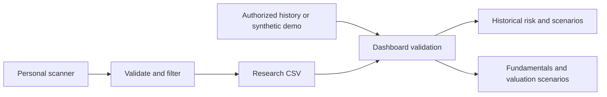

# AlphaScope — Investment Intelligence
## Quantitative finance toolkit: technical and research case study

Independent portfolio project | Samuel Ndungu Njoroge

### 1. Problem
Low nominal asset prices can attract investor attention without establishing intrinsic value. AlphaScope separates asset discovery from risk measurement, fundamental assessment and historical scenario analysis. The project is a research toolkit, not an investment recommendation engine.

### 2. Data and design

The personal research scanner uses eight selected US equities and up to 250 large-cap-ranked cryptocurrencies. It records collection timestamps and errors. The initial filters require positive finite market capitalization, price at most USD 5 and daily dollar turnover of at least USD 100,000. Equity turnover is approximated and is not directly comparable with provider-reported crypto turnover.

The interactive dashboard uses fictional examples by default, or authorized user-supplied snapshots and adjusted price histories. Live data redistribution rights are not established.



### 3. Implemented quantitative methods

| Module | Method | Interpretation |
|---|---|---|
| Screening | Explicit price and turnover thresholds | Discovery only |
| Risk | Annualized return, volatility, Sharpe, Sortino, drawdown, historical VaR | Retrospective risk descriptors |
| Backtest | Fixed-universe daily equal weights and transaction costs | Illustrative; survivorship bias possible |
| Scenario | Joint IID return bootstrap | Not calibrated future probabilities |
| Valuation | Assumed earnings multiple and diluted shares | Scenario, not intrinsic value |
| Fundamentals | FCF, margins, yield, debt/equity and ROE | User-supplied inputs |

Equities and daily crypto require different calendars. Adjusted prices and corporate-action handling remain user responsibilities. Missing or invalid inputs are not interpreted as zero.

### 4. Executed validation

The [manual collection workflow](https://github.com/samuel6183/alphascope-investment-intelligence/actions/runs/45915690743) logged 258 collected assets, 186 passing the initial filter and zero collection errors. This is a limited collection snapshot, not an investment opportunity count or evidence of profitability. The [later validation run](https://github.com/samuel6183/alphascope-investment-intelligence/actions/runs/45916660455) passed 19 automated tests covering screening, dashboard validation and quantitative functions.

### 5. Reproduction and demonstration

```bash
python -m pip install -r requirements.txt
python -m unittest discover -s tests -v
streamlit run app.py
```

For authorized personal data acquisition, run `python scan.py`. Inspect rejected rows and collection errors. The Streamlit dashboard allows price, liquidity and asset-class filtering, historical risk assessment, portfolio scenarios and manually entered fundamentals.

### 6. Limitations and future work

No predictive model, verified alpha, automated execution, public market data feed or production-ready investment service is claimed. A realistic strategy study requires point-in-time universes, delisted assets, out-of-sample testing and relevant costs. Public hosting, licensing and data rights are outstanding. The code is for research and education, not financial advice.

[Release methodology](docs/release.md) · [Screening assumptions](docs/methodology.md) · [Deployment instructions](docs/deployment.md) · [Due diligence research](docs/advanced-due-diligence-2026-11-27.md)
