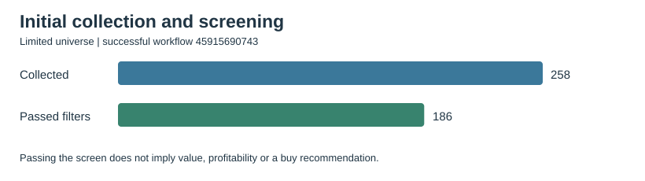

# AlphaScope | Quantitative Investment Intelligence

**Research toolkit for screening, historical risk analysis and scenario-based valuation**

[Read the technical case study](CASE_STUDY.md) · [Methods and limitations](docs/release.md) · [Dashboard source](app.py)

## What the project does
AlphaScope separates low-price asset discovery from financial risk measurement and valuation scenarios. It uses authorized user-provided data or clearly labeled fictional examples; it is not a trading or investment advice platform.



| Evidence | Result |
|---|---|
| Initial personal collection | 258 assets; 186 passed heuristic filters; zero logged collection errors |
| Automated validation | [19 tests passed](https://github.com/samuel6183/alphascope-investment-intelligence/actions/runs/45916660455) |
| Historical risk | Return, volatility, Sharpe, Sortino, drawdown and VaR |
| Portfolio research | Fixed-universe backtest and bootstrap scenarios |
| Fundamentals | User-entered ratios and earnings-multiple scenarios |

## Try the application locally
```bash
python -m pip install -r requirements.txt
python -m unittest discover -s tests -v
streamlit run app.py
```

The [successful personal scan](https://github.com/samuel6183/alphascope-investment-intelligence/actions/runs/45915690743) was a limited universe snapshot. Passing a filter is not a buy signal. The public dashboard is not confirmed deployed; licensing and public data-feed rights remain outstanding. No demonstrated predictive performance or real trading gains are claimed.

[Research methodology](docs/methodology.md) · [Deployment guide](docs/deployment.md) · [Research portfolio](https://github.com/samuel6183)

## Verification status

[](https://github.com/samuel6183/alphascope-investment-intelligence/actions/workflows/validate.yml)

[Latest successful validation inspected on 28 November 2026](https://github.com/samuel6183/alphascope-investment-intelligence/actions/runs/45922795706). This is evidence of automated workflow execution, not independent scientific replication or a verified public deployment.
